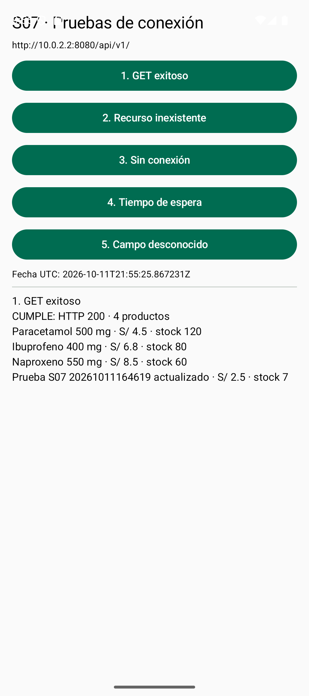
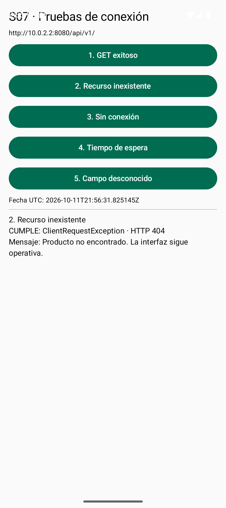
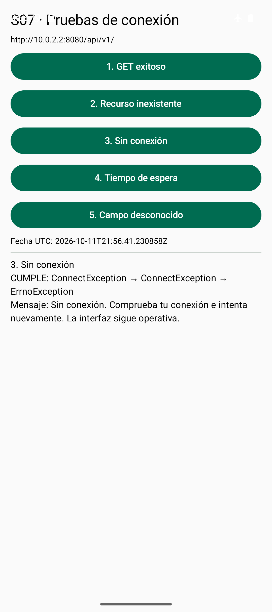
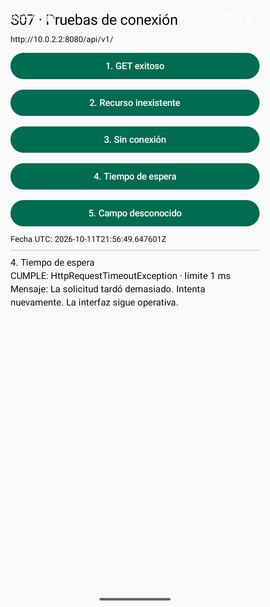
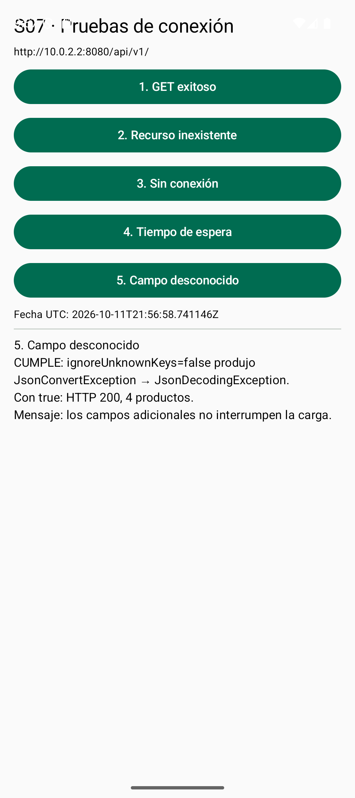

# S07 - Actividad autónoma: endpoints, DTO y pruebas de conexión

**Estudiante:** Grease Duran Castro  
**Proyecto:** PharmaMobil sobre PharmaSoft  
**Repositorio:** https://github.com/GreysiLL/AA  
**Rama:** feature/ktor-client-duran  
**Fecha de preparación:** 11 de octubre de 2026 (America/Lima)

## 1. Catálogo de endpoints

API versión v1. En Windows el backend se consulta en `http://localhost:8080/api/v1/`; el emulador Android usa `http://10.0.2.2:8080/api/v1/`. El simulador iOS usa `http://localhost:8080/api/v1/` en la Mac donde se ejecute PharmaSoft. Ese localhost no accede automáticamente al backend de la computadora Windows.

| Método | Ruta | Parámetros / cuerpo | Respuesta verificada | Errores ejecutados |
|---|---|---|---|---|
| GET | /productos | pagina=0, tamanio=20, ordenarPor=id, direccion=asc | 200, página con contenido y metadatos | 409, página negativa |
| GET | /productos/{id} | id: Long | 200, ProductoResponseDTO | 400, ID no numérico; 404, ID inexistente |
| POST | /productos | nombre, precio, stock, estado, categoriaId | 201, producto creado | 400, validación; 409, nombre duplicado |
| PUT | /productos/{id} | id + los mismos campos del POST | 200, producto actualizado | 400, validación; 404, ID inexistente |
| DELETE | /productos/{id} | id: Long | 204, sin cuerpo; baja lógica | 404, ID inexistente; 409, producto ya inactivo |

Rangos del listado: pagina >= 0; tamanio de 1 a 100; ordenarPor en id, nombre, precio, stock; direccion en asc o desc. El controlador usa los valores predeterminados de la tabla.

Todos los campos del cuerpo POST/PUT son obligatorios: nombre de 3 a 150 caracteres, precio >= 0.01, stock >= 0, estado Boolean y categoriaId Long de una categoría existente. Las pruebas usaron una categoría ya creada. Los errores adicionales previstos por el código, pero no forzados, son 404 para una categoría inexistente y 500 para fallos inesperados. No se afirma haber probado 401: este backend de desarrollo no incorpora autenticación JWT en el alcance actual.

DELETE no elimina físicamente: cambia estado a false. Una consulta posterior al mismo ID devuelve 200 y estado=false; el listado general también incluye inactivos. Las pruebas de POST, PUT y DELETE se realizaron exclusivamente sobre un producto temporal de laboratorio, preservando los registros existentes.

El catálogo cubre los endpoints que se utilizarán en la sesión 8; en la app el listado y la consulta por ID son GET. El registro del formulario continúa en memoria durante la sesión 7.

### Solicitud real usada para POST

```json
{
  "nombre": "Prueba S07 20261011164619",
  "precio": 1.25,
  "stock": 5,
  "estado": true,
  "categoriaId": 1
}
```

## 2. Diccionario de DTO

Se documentan todos los DTO declarados en el código móvil: ProductoResponseDto y PaginaResponseDto<T>. Los DTO del servidor tienen nombres Java y no se confunden con el tipo Kotlin del cliente.

### ProductoResponseDto

| Campo JSON | Tipo Kotlin | Obligatorio para deserializar | Valor predeterminado | Correspondencia en dominio |
|---|---|---|---|---|
| id | Long | Sí | Sin valor | Producto.id |
| nombre | String | Sí | Sin valor | Producto.nombre |
| precio | Double | Sí | Sin valor | Producto.precio |
| stock | Int | Sí | Sin valor | Producto.stock |
| estado | Boolean | No | true | No se mapea al Producto actual |
| categoriaId | Long? | No | null | No se mapea |
| categoriaNombre | String? | No | null | No se mapea |

### PaginaResponseDto<T>

| Campo JSON | Tipo Kotlin | Obligatorio | Valor predeterminado | Correspondencia en dominio |
|---|---|---|---|---|
| contenido | List<T> | Sí | Sin valor | Cada ProductoResponseDto se transforma en Producto |
| pagina | Int | Sí | Sin valor | Metadato de transporte; sin campo en Producto |
| tamanio | Int | Sí | Sin valor | Metadato de transporte; sin campo en Producto |
| totalElementos | Long | Sí | Sin valor | Metadato de transporte; sin campo en Producto |
| totalPaginas | Int | Sí | Sin valor | Metadato de transporte; sin campo en Producto |
| ultima | Boolean | Sí | Sin valor | Metadato de transporte; sin campo en Producto |

Los campos fechaCreacion y fechaModificacion del servidor no están declarados en el DTO móvil: se toleran mediante ignoreUnknownKeys=true. La nulabilidad y la obligatoriedad anteriores se refieren exactamente al constructor Kotlin; no sustituyen las validaciones de entrada del backend.

### Código de los DTO

```kotlin
package pe.edu.upeu.pharmamobil.data.remote.dto
import kotlinx.serialization.Serializable

@Serializable
data class ProductoResponseDto(
    val id: Long,
    val nombre: String,
    val precio: Double,
    val stock: Int,
    val estado: Boolean = true,
    val categoriaId: Long? = null,
    val categoriaNombre: String? = null
)

```
```kotlin
package pe.edu.upeu.pharmamobil.data.remote.dto
import kotlinx.serialization.Serializable

@Serializable
data class PaginaResponseDto<T>(
    val contenido: List<T>,
    val pagina: Int,
    val tamanio: Int,
    val totalElementos: Long,
    val totalPaginas: Int,
    val ultima: Boolean
)

```
### Fragmento de JSON real

Se muestra el primer elemento; los metadatos se conservan tal como los devolvió el servidor.

```json
{
  "contenido": [
    {
      "id": 1,
      "nombre": "Paracetamol 500 mg",
      "precio": 4.5,
      "stock": 120,
      "estado": true,
      "categoriaId": 1,
      "categoriaNombre": "Analgésicos",
      "fechaCreacion": "2026-10-09T16:45:39.588859",
      "fechaModificacion": null
    }
  ],
  "pagina": 0,
  "tamanio": 20,
  "totalElementos": 3,
  "totalPaginas": 1,
  "ultima": true
}
```

### Mapeo

```kotlin
fun ProductoResponseDto.toDomain(): Producto = Producto(id, nombre, precio, stock)
```

El dominio valida nombre no vacío, precio positivo y finito, y stock no negativo. No lleva @Serializable ni referencias a Ktor.

## 3. Bitácora de conexión

Los resultados HTTP se conservan íntegros en endpoints-ejecutados.json. Son pruebas reales del backend desde Windows; no se presentan como ejecución del cliente Ktor en Android. Las pruebas visuales Android se registran por separado, junto a fecha, resultado y captura.

| ID | Escenario Android | Pasos | Resultado esperado |
|---|---|---|---|
| PC-01 | Respuesta exitosa | Con red activa, ejecutar GET exitoso | HTTP 200 y nombres de productos en pantalla |
| PC-02 | Recurso inexistente | Consultar ID Long.MAX_VALUE | ClientRequestException 404; Producto no encontrado |
| PC-03 | Sin conexión | Activar modo avión y desactivar Wi-Fi; ejecutar Sin conexión | Fallo de red capturado; mensaje para reintentar |
| PC-04 | Tiempo agotado | Cliente exclusivo con requestTimeoutMillis=1; ejecutar Tiempo de espera | HttpRequestTimeoutException y UI operativa |
| PC-05 | Campo desconocido | GET real con ignoreUnknownKeys=false; repetir con true | Error JSON al encontrar fechas; con true, carga exitosa |

Los cambios de configuración para timeout y JSON se aplican únicamente a clientes temporales de prueba. El cliente habitual mantiene 15000 ms, ignoreUnknownKeys=true y Logging HEADERS. Cada cliente temporal se cierra al terminar.

La pantalla de laboratorio se abre desde la Activity de desarrollo PruebasConexionActivity; no se registra en el manifiesto de release. El formulario y la pantalla normal de inventario se conservan.

## 4. Evidencias y repositorio

Las cinco pruebas se ejecutaron en Android el 11 de octubre de 2026: todas cumplieron el resultado esperado. Capturas en capturas/PC-01.png a PC-05.png; fecha, resultado y conclusión en bitacora-android.json. Registro real exportado en ktor-android.log. La evidencia iOS queda pendiente porque la estudiante no dispone de una computadora Apple con Xcode. La ejecución de pruebas automatizadas Gradle no se acredita con estos resultados visuales.

## Registro de las peticiones del catálogo

- 2026-10-11T16:46:18.244805-05:00 - GET /productos?pagina=0&tamanio=20 - HTTP 200 - Listado real.
- 2026-10-11T16:46:19.077499-05:00 - GET /categorias - HTTP 200 - Categoría disponible.
- 2026-10-11T16:46:19.112153-05:00 - GET /productos/1 - HTTP 200 - Detalle existente.
- 2026-10-11T16:46:19.155240-05:00 - GET /productos/9223372036854775807 - HTTP 404 - Detalle inexistente.
- 2026-10-11T16:46:19.186835-05:00 - GET /productos/abc - HTTP 400 - Identificador no numérico.
- 2026-10-11T16:46:19.207366-05:00 - GET /productos?pagina=-1 - HTTP 409 - Paginación inválida.
- 2026-10-11T16:46:19.239908-05:00 - POST /productos - HTTP 201 - Crear producto exclusivo de prueba.
- 2026-10-11T16:46:19.665705-05:00 - POST /productos - HTTP 409 - Nombre duplicado.
- 2026-10-11T16:46:19.684330-05:00 - POST /productos - HTTP 400 - Validación de cuerpo.
- 2026-10-11T16:46:19.707918-05:00 - PUT /productos/21 - HTTP 200 - Actualizar producto de prueba.
- 2026-10-11T16:46:19.785229-05:00 - PUT /productos/21 - HTTP 400 - Actualización inválida.
- 2026-10-11T16:46:19.808442-05:00 - PUT /productos/9223372036854775807 - HTTP 404 - Actualizar ID inexistente.
- 2026-10-11T16:46:19.849995-05:00 - DELETE /productos/21 - HTTP 204 - Baja lógica del producto de prueba.
- 2026-10-11T16:46:19.875997-05:00 - DELETE /productos/21 - HTTP 409 - Repetir baja lógica.
- 2026-10-11T16:46:19.910099-05:00 - DELETE /productos/9223372036854775807 - HTTP 404 - Eliminar ID inexistente.
- 2026-10-11T16:46:19.928005-05:00 - GET /productos/21 - HTTP 200 - Verificar persistencia tras baja lógica.

## Resultados observados en Android

### PC-01

Fecha Lima: 2026-10-11T16:55:25.867231-05:00

1. GET exitoso
CUMPLE: HTTP 200 · 4 productos
Paracetamol 500 mg · S/ 4.5 · stock 120
Ibuprofeno 400 mg · S/ 6.8 · stock 80
Naproxeno 550 mg · S/ 8.5 · stock 60
Prueba S07 20261011164619 actualizado · S/ 2.5 · stock 7



El resultado observado corresponde al escenario esperado.

### PC-02

Fecha Lima: 2026-10-11T16:56:31.825145-05:00

2. Recurso inexistente
CUMPLE: ClientRequestException · HTTP 404
Mensaje: Producto no encontrado. La interfaz sigue operativa.



El resultado observado corresponde al escenario esperado.

### PC-03

Fecha Lima: 2026-10-11T16:56:41.230858-05:00

3. Sin conexión
CUMPLE: ConnectException → ConnectException → ErrnoException
Mensaje: Sin conexión. Comprueba tu conexión e intenta nuevamente. La interfaz sigue operativa.



El resultado observado corresponde al escenario esperado.

### PC-04

Fecha Lima: 2026-10-11T16:56:49.647601-05:00

4. Tiempo de espera
CUMPLE: HttpRequestTimeoutException · límite 1 ms
Mensaje: La solicitud tardó demasiado. Intenta nuevamente. La interfaz sigue operativa.



El resultado observado corresponde al escenario esperado.

### PC-05

Fecha Lima: 2026-10-11T16:56:58.741146-05:00

5. Campo desconocido
CUMPLE: ignoreUnknownKeys=false produjo JsonConvertException → JsonDecodingException.
Con true: HTTP 200, 4 productos.
Mensaje: los campos adicionales no interrumpen la carga.



El resultado observado corresponde al escenario esperado.

