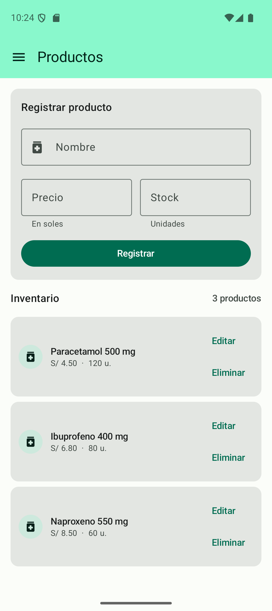
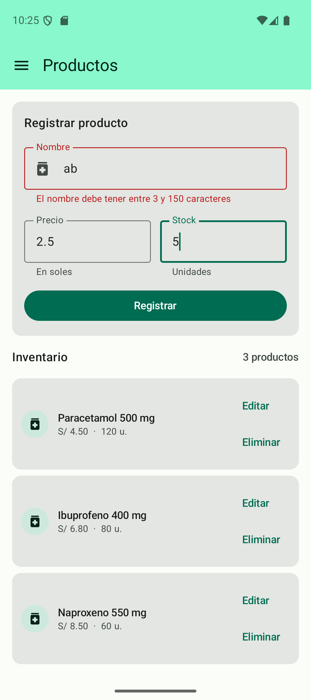
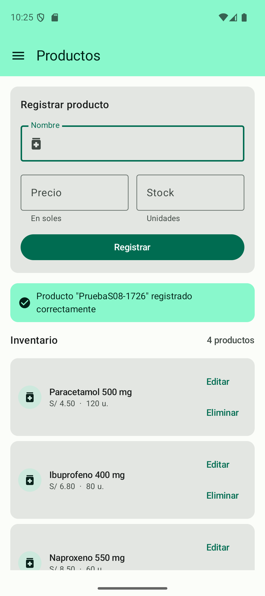
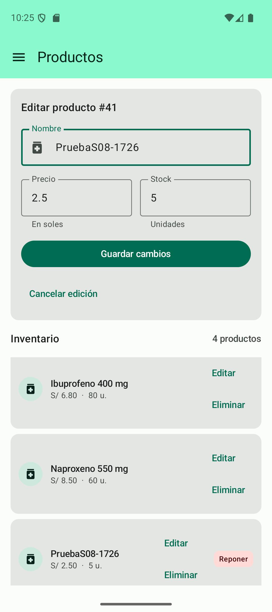
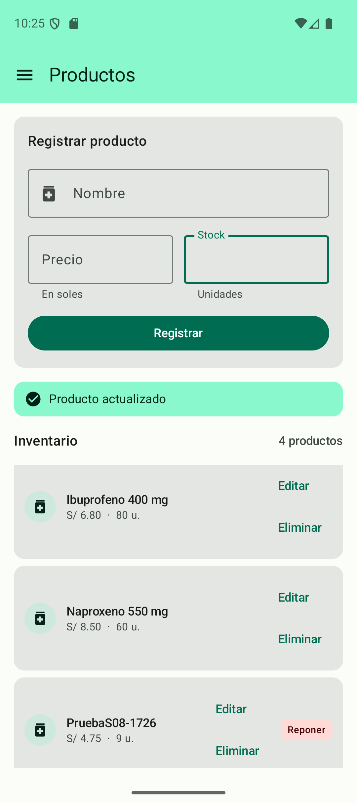
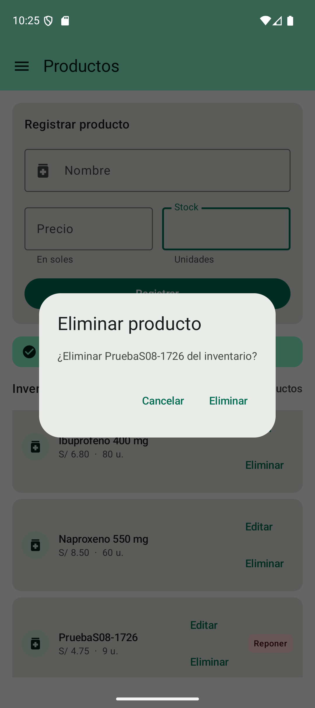
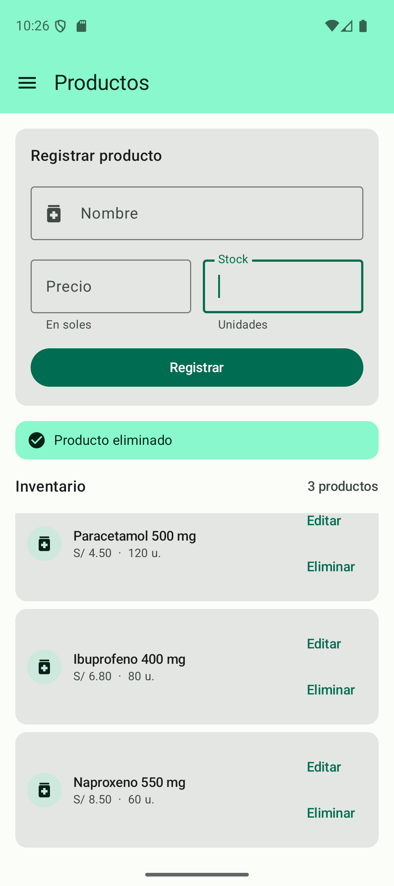

# Práctica S08 - CRUD REST

Estudiante: Grease Duran Castro. Rama: feature/crud-productos-duran.

## Implementación

- GET paginado de todas las páginas; inventario de productos activos.
- GET por ID antes de editar o abrir detalle.
- POST y PUT con nombre, precio, stock, estado y categoriaId; categoría predeterminada 1, validada en PharmaSoft.
- DELETE 204 sin deserializar; baja lógica. El producto inactivo se conserva en Oracle y sale del inventario.
- ErrorApi y ejecutarLlamada centralizan 400, 404, 409, 5xx, desconexión, timeout y JSON inválido. CancellationException se relanza.
- Operacion separa guardar, editar y eliminar de la fase de listado. La recarga después de una mutación conserva la lista visible; un fallo de recarga informa que el servidor ya recibió la operación.
- Nombre con dos caracteres pasa la validación local de no vacío para comprobar el 400 real del servidor bajo el campo nombre.
- Los metadatos originales de categoría y estado se conservan al actualizar.

## Resultados verificados - 11/10/2026

Repositorio de entrega: https://github.com/GreysiLL/act.prac-2

Rama: feature/crud-productos-duran, creada desde develop e integrada con la base de sesión 07 por avance rápido. No se descartaron los cambios previos del proyecto.

- GET /api/health: HTTP 200; Oracle y PharmaSoft operativos.
- APK debug: BUILD SUCCESSFUL; instalado en Pixel 9, API 36.
- Suite Android host: 63 pruebas, 0 fallos. Registro completo en [pruebas-automatizadas.log](pruebas-automatizadas.log).
- Inventario: 3 productos activos antes de crear, 4 después de crear y actualizar, 3 tras eliminar.
- Producto exclusivo PruebaS08-1726, ID 41. Creado con precio 2.5 y stock 5; actualizado a 4.75 y stock 9; eliminado lógicamente, estado=false. Categoría 1 conservada.
- Nombre de dos caracteres: el servidor responde 400; mensaje bajo Nombre; listado visible.
- Registro Ktor real del emulador: [ktor-android.log](ktor-android.log). Incluye GET 200, POST 400 y 201, PUT 200 y DELETE 204. Horas del registro en UTC; bitácora en hora de Lima. El reloj visible del emulador usa otra zona horaria.

Los registros de pruebas automatizadas usan MockEngine; los registros ktor-android.log y las capturas corresponden a peticiones reales a PharmaSoft. No se mezclan ambas evidencias.

### Correcciones verificadas

Json.encodeDefaults=true asegura que estado=true no sea omitido del POST/PUT. Una prueba de regresión comprueba ese campo obligatorio. Se conservan CancellationException y los errores tipificados. Las validaciones que no pertenecen a los campos visibles se muestran como mensaje de operación.

### Evidencia iOS

No ejecutada: no se dispone de computadora Apple con Xcode. Las capturas Android no acreditan ejecución iOS.

## Bitácora y capturas Android

### 01-listado

Fecha Lima: 2026-10-11T17:24:47.418130-05:00

GET 200: tres productos activos en el inventario.

### 02-error400

Fecha Lima: 2026-10-11T17:25:09.212476-05:00

HTTP 400: mensaje real del servidor bajo Nombre; inventario visible.

### 03-creacion

Fecha Lima: 2026-10-11T17:25:23.800952-05:00

POST 201: PruebaS08-1726, ID 41, precio 2.5 y stock 5 persistidos.

### 04-obtener

Fecha Lima: 2026-10-11T17:25:36.093373-05:00

GET por ID: formulario cargado con el producto y sus datos originales.

### 05-actualizacion

Fecha Lima: 2026-10-11T17:25:53.626282-05:00

PUT 200: precio 4.75 y stock 9 persistidos; categoría original conservada.

### 06-confirmacion

Fecha Lima: 2026-10-11T17:26:02.604022-05:00

La eliminación solicita confirmación para el producto de prueba.

### 07-eliminacion

Fecha Lima: 2026-10-11T17:26:13.826359-05:00

DELETE 204: baja lógica confirmada en Oracle, estado=false; vuelve a tres productos activos.

## Persistencia comprobada

Se consultó el backend después de cada operación de la app, sin modificar productos preexistentes:

- [Respuesta después de crear](03-creacion-servidor.json).
- [Respuesta después de actualizar](05-actualizacion-servidor.json).
- [Respuesta después de eliminar](07-eliminacion-servidor.json): conserva el registro con estado=false.

## Reproducir

1. Iniciar Oracle en Docker y PharmaSoft con el perfil dev.
2. Ejecutar verificar-sesion08.ps1 desde la raíz del proyecto.
3. Ejecutar androidApp en Android Studio y abrir Productos.
4. Crear un nombre exclusivo con precio y stock válidos; pulsar Editar, Guardar cambios y Eliminar.
5. Para comprobar el 400 real, usar nombre ab y valores numéricos válidos.

La categoría por defecto es 1. Los productos editados conservan su categoría original. No se implementa autenticación JWT ni persistencia offline en esta práctica; esos temas corresponden a sesiones posteriores.
