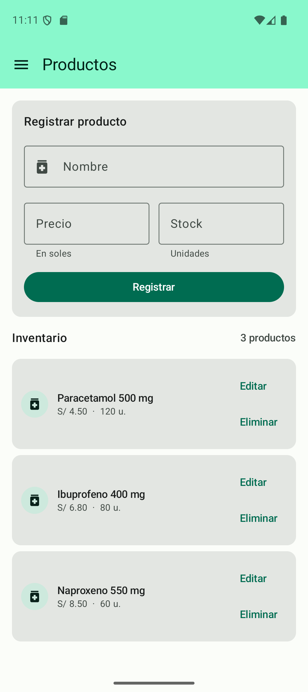
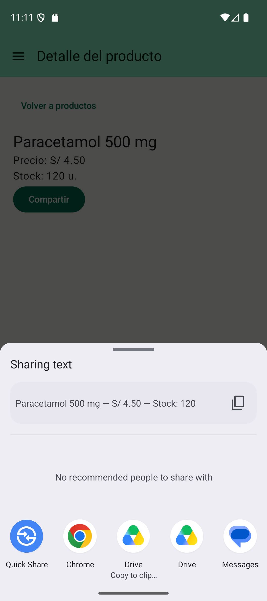
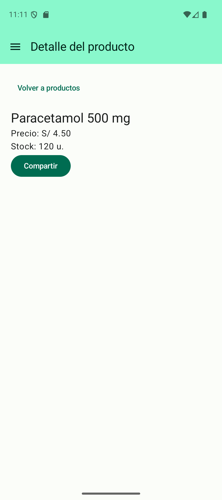
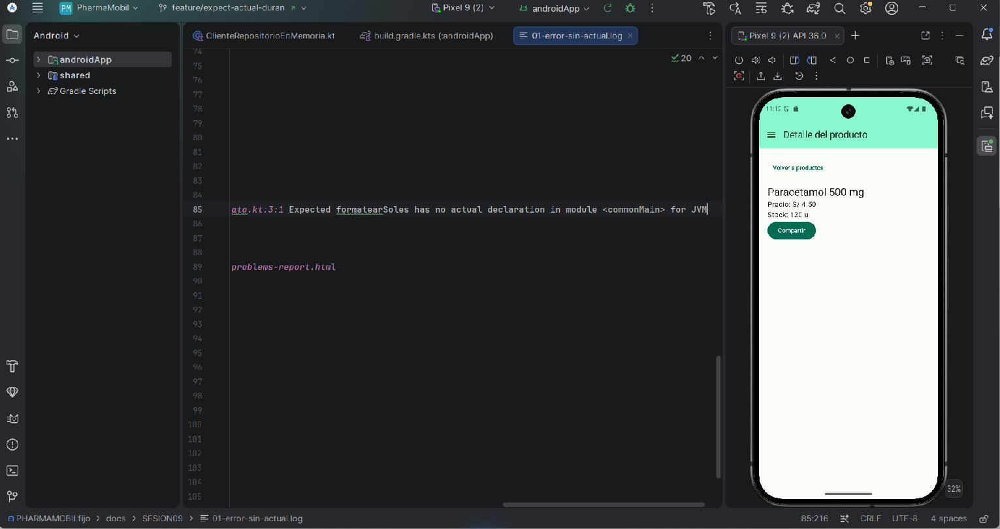

# Práctica 09 - Capacidades nativas con expect/actual

Estudiante: Grease Duran Castro. Verificación Android: 11/10/2026.

Repositorio: https://github.com/GreysiLL/Activi-09-pract/tree/feature/expect-actual-duran

## Implementación

El código nativo de la práctica ya estaba implementado. La rama feature/expect-actual-duran conserva los tres commits originales y ahora incluye el CRUD REST reciente mediante avance rápido desde feature/crud-productos-duran.

| Capacidad | Código común | Android | iOS |
|---|---|---|---|
| Moneda peruana | expect fun formatearSoles(Double): String | NumberFormat, Locale es/PE | NSNumberFormatter, NSLocale es_PE |
| Compartir | Interfaz domain.platform.Compartidor | Intent ACTION_SEND, text/plain, EXTRA_TEXT, createChooser y FLAG_ACTIVITY_NEW_TASK | UIActivityViewController desde la ventana activa; popover configurado |
| Inyección | expect val platformModule | CompartidorAndroid(androidContext()) | CompartidorIos() |

Producto.aUi aplica el formato al preparar ProductoUi. El dominio conserva el precio numérico. El texto para compartir se arma en código común como nombre, precio formateado y stock. DetalleProductoViewModel obtiene el producto por ID del repositorio REST e invoca el contrato Compartidor; la pantalla Compose llama al ViewModel.

MainApplication inicializa Koin con androidContext. Ningún archivo de presentation importa android. ni platform.UIKit (búsqueda estática verificada).

## Verificación real Android

- Backend /api/health: HTTP 200.
- Inventario de PharmaSoft: tres productos activos; precio S/ 4.50 para Paracetamol 500 mg.
- El detalle obtiene producto/1 y muestra precio y stock 120.
- Compartir abre el selector nativo con Paracetamol 500 mg — S/ 4.50 — Stock: 120.
- Se cancela el selector y el detalle permanece operativo. No se envía el texto a otra aplicación.
- La versión de código utilizada coincide con la verificación reciente de 69 pruebas Android host sin fallos; salida real conservada en 06-pruebas-actuales.log. No se confunden estas pruebas con las capturas del selector.

### 01-listado-actual

Fecha Lima: 2026-10-11T18:11:11.742922-05:00

Tres productos reales activos de PharmaSoft con precios en soles y dos decimales.

### 02-detalle-actual

Fecha Lima: 2026-10-11T18:11:18.668053-05:00

GET producto/1: detalle con nombre, precio formateado y stock.

### 03-selector-actual

Fecha Lima: 2026-10-11T18:11:26.497607-05:00

Selector nativo Android muestra nombre, importe S/ 4.50 y Stock: 120. No se envió el texto a ninguna aplicación.

### 04-regreso-detalle

Fecha Lima: 2026-10-11T18:11:30.368653-05:00

Cancelar el selector conserva el detalle; no aparece error nativo.

## Punto de control: falta de actual

01-error-sin-actual.log conserva el error original del compilador: Expected formatearSoles has no actual declaration in module <commonMain> for JVM.

La captura siguiente muestra ese registro auténtico abierto en Android Studio. Es una captura actual del registro histórico; no se afirma que la versión completa de hoy esté fallando ni se modificó el registro para simular un error nuevo.

## Interoperabilidad Kotlin-Swift revisada

- shared/build.gradle.kts establece baseName = Shared para el framework.
- iosApp/iosApp/iOSApp.swift importa Shared y llama KoinIosKt.doInitKoinIos().
- iosApp/iosApp/ContentView.swift crea el controlador Compose con MainViewControllerKt.MainViewController().
- Los actual de formato y platformModule viven en iosMain; la pantalla y el contrato permanecen en commonMain.

## Commits originales

- f8c510e: formato de moneda con expect/actual.
- f64da3d: detalle y compartir nativo mediante Koin.
- 16bfbca: pruebas y documentación de capacidades nativas.

Las evidencias actuales y el CRUD reciente se incorporan en una actualización posterior de la misma rama.

## iOS

Código preparado y revisado, pero no compilado ni ejecutado por falta de Mac/Xcode. Quedan pendientes las capturas de formato y hoja de compartir en iOS. Las pruebas Android no acreditan ejecución iOS.

## Reproducir

Mantener Oracle/Docker y PharmaSoft funcionando. Ejecutar androidApp, abrir Productos, tocar una tarjeta y pulsar Compartir. Verificar la vista previa del texto y cancelar para regresar al detalle.

verificar-sesion09.ps1 compila el APK y ejecuta las pruebas Android host. subir-practica09.ps1 publica solo feature/expect-actual-duran en el repositorio indicado.
